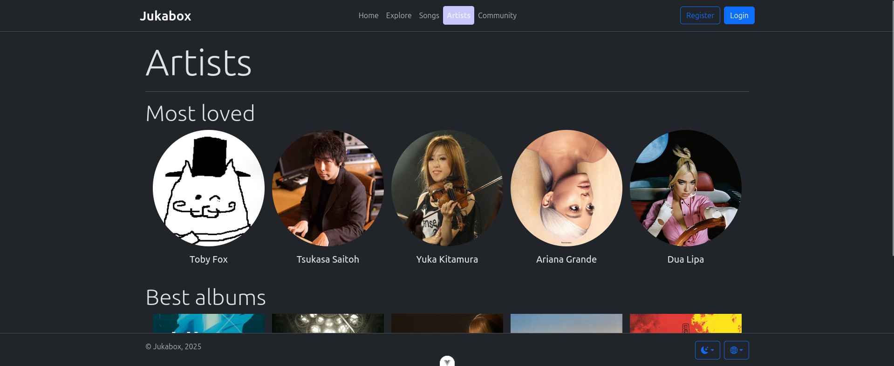

# Jukabox

  

This project is a full-stack app using Vue.js for the front-end and Django for the back-end, integrated with the MusicBrainz API to fetch and display music data like artists, albums, and tracks.

This project was developed as final project for our Web Application Development formation.

## :wrench: Technologies

### For backend

- `Django`
- `pip`
- `Python`
- `django-rq` package.
- `redis` package.
- `requests` package.
- `musicbrainzngs` package.

### For frontend

- `HTML`
- `CSS`
- `SCSS`
- `JavaScript`
- `TypeScript`
- `Vite + Vue`
- `Bootstrap + Bootstrap Icons`
- `Eslint`
- `Prettier`
- `Pinia`
- `vue-i18n` package.
- `vue-router` package.

## :star: Features

1. **Create your account** and follow artists, albums and songs that you liked!
2. **Find where you can play records** following the links generated by the backend to another media like Spotify or Deezer.
3. You can't find your favorite album? **No problem! Add it by yourself** with our **Importer system**, that integrate data from MusicBrainz using the API MBID (own identifier).

## :eyes: Demostration

  

## :book: What we learned

### How create a full-stack application

As our first full-stack application, we learned how connect a backend and frontend section of the project using HTTP requests, managing at the same time the error handling or the use of decoupled tasks.

### What important is use a version control system

Github was our version control tool that helps us maintaining our changes and organize our roles, commits and tasks using the issues system and the project's kanban view.

### How work as team

The first challenge of this project was organize us as team, testing our social skills and patience to keep working in a healthy and friendly way with our differences.

